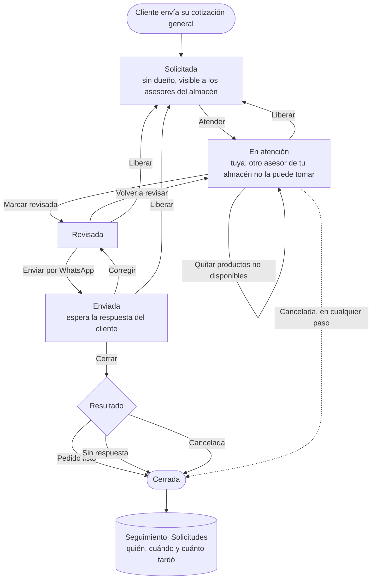

# ESTADO — Catálogo de Inventario (Grupo Camejo)

## Qué es
PWA de un solo archivo con el catálogo de refacciones de Grupo Camejo. La usan administración, vendedores y clientes (con login). Corre en GitHub Pages y lee/escribe en Google Sheets mediante Apps Script.

## Cómo está armado
- `index.html`: toda la app (login, catálogo, carrito del cliente, panel de Cotizaciones Pendientes, galería de fotos). Estilos con Tailwind (CDN) y los tokens de `MASTER.md` en `:root` (`--brand`, `--surface`, `--text-3`…). Botones verdes con `.btn-primary`, ámbar con `.btn-attention`, insignias con `.badge-brand`; no volver a usar `bg-emerald-600 text-white` (no pasa contraste).
- `MASTER.md`: sistema visual del rediseño (fuente única de verdad del diseño).
- **Cotizar en piso de venta** (`index.html`, bloque `js-cotizar-piso`, prefijo `cotPiso*`/`_cp*`): botón flotante "Cotizar" solo para `esAdmin` (admin, vendedor, gerente). Captura ID de cliente, nombre, teléfono, motocicleta y año (opcionales) y productos por SKU, nombre o número de parte; sin selector de Agencia (decisión 7). Los precios que se ven son de apoyo y el servidor los recalcula al guardar. Una línea bajo pedido lleva número de parte (solo lo ve el vendedor, no sale en la hoja) y precio aproximado capturado a mano hasta que exista la lista de precios del REPORTEADOR.
- **Hoja de cotización** (`index.html`, bloque `HOJA_COTIZACION_INICIO … FIN`): PDF tamaño carta, tipo factura, siempre claro. `hojaCotizacionConstruir` arma el PDF (jsPDF 2.5.1, se carga solo la primera vez), `hojaCotizacionPdf` lo comparte en el celular o lo descarga. Botón **Hoja PDF** al guardar la cotización y en Configuración → Cotizaciones. Lleva fecha, folio, cliente (con ID), teléfono, asesor, motocicleta y año si se capturaron, partidas con importe, total y notas; partidas sin precio salen "Por confirmar" y no suman, precios aproximados llevan `*`. Nunca lleva número de parte ni costos. Logo de la hoja según la agencia del asesor, que se deduce de su almacén (columna H): **Vento**, **Carabela**, **Suzuki** o **Bajaj** (cualquier sucursal Bajaj) llevan su logo. Con "TODAS", vacío u otro almacén la agencia queda `GENERAL`: sin logo, con el nombre "La Barata del Hogar". Si la cuenta es **vendedor**, la hoja también lleva su agencia (columna H) y su WhatsApp (columna G); admin y gerente no.
- `sw.js`: service worker. El nombre de caché es fijo (`catalogo-bh-shell`); no hace falta subir versión a mano.
- `manifest.json` e iconos (`icon-192.png`, `icon-512.png`, `apple-touch-icon.png`, `favicon.ico`) e `imagen-no-disponible.png`.
- Backend: repo `coodinadorgenref-GC/apps-script` (se sube con clasp). Los archivos .gs que alimentan el API:
  - `Código.js`: login, sesiones, roles, carritos, cotizaciones, bitácora, Telegram.
  - `Inventario_base.js`: inventario del catálogo leído de DATOS, con los filtros en código.
  - `Precios_venta.js`: precios calculados en el servidor; el COSTO nunca sale del servidor.
  - `Cotizaciones.js`: hoja `COTIZACIONES` (una fila por folio `C00001`…), `guardarCotizacion`, `listarCotizaciones`, `cambiarEstadoCotizacion` (Borrador · Enviada · Aceptada · Rechazada · Cancelada). El folio sale de un contador (`FOLIO_COTIZACION` en Propiedades del script) con candado; los precios los calcula el servidor.
  - `Motos.js`: hoja `Motos` (se crea sola) con los modelos de motocicleta; `listarMotos` alimenta las sugerencias del formulario de Cotizar y `_registrarMoto_` agrega el modelo nuevo al guardar o editar una cotización (guardado en MAYÚSCULAS, sin duplicados por espacios, acentos o guiones).
  - `Lista_vento.js`: hoja `LISTA_VENTO` (número de parte, descripción, costo, disponibilidad, aplicación, fecha de recibo). Se sube desde el REPORTEADOR con los dos Excel de VENTO (precios e inventario). `consultarParteVento` devuelve el precio aproximado = costo × 1.16 / 0.6 (con IVA; el costo no sale del servidor) y la disponibilidad.
  - `Cuentas.js`: alta de cuentas desde el REPORTEADOR (solo admin real) directo a `Usuarios_Autorizados` (A–L, todo obligatorio; Token_Acceso y Código de Acceso se generan solos; el código no se escribe en la bitácora).
  - `Compat_revision.js`: al pasar una cotización a **Vendido**, compara cada SKU del catálogo con la compatibilidad de su ficha (`Inventario`, columna D); si la moto cotizada no aparece crea un pendiente en la hoja `REVISION_COMPAT` y avisa por Telegram a las cuentas ROL admin. Se atiende en Configuración › Compatibilidad (solo admin real).
  - `Cuentas.js` también consulta y edita cuentas desde el REPORTEADOR (`consultarCuentas`, `editarCuenta`, `resetearCodigoCuenta`): se puede cambiar cualquier dato, incluido el usuario de la columna A (se cierran sus sesiones y sus cotizaciones pasan al usuario nuevo); restablecer la contraseña genera un código nuevo, borra el token y cierra las sesiones. Nunca devuelve el código ni el token. No deja que un admin se desactive, se quite el permiso ni cambie su propio usuario.
  - `Sesion_rol.js`, `Codigo_Reporteador.js`, `Cierres_mensuales.js`, `Subidas_y_meses.js`, `Talleres.js`, `Inventario_pegado.js`.
- Datos: Google Sheets, expuestos por el Worker de Cloudflare `catalogo-labarata-proxy`.
- Apps hermanas: REPORTEADOR (dashboard) y Maps (prospectos, rutas y notas de venta).

## Roles (columna F de `Usuarios_Autorizados`)
- `admin`: permisos completos; es el único "admin real" (Maps, Talleres, Reporteador completo).
- `vendedor`: mismos permisos que admin dentro del catálogo; además entra a Maps.
- `gerente` (nuevo): mismos permisos que vendedor en el catálogo, **sin acceso a Maps** por ahora. El servidor usa `_tienePermisosDeAdmin` (`Código.js`), pero el login le manda `esAdmin:false` y `esGerente:true`; así Maps lo rechaza solo y el catálogo lo trata como admin con `esAdmin || esGerente`. En el REPORTEADOR entra con alcance de vendedor (solo la agencia de su columna H) y ve Talleres solo de esa agencia (`obtenerTalleres`).
- Cualquier otro valor (vacío, cliente): cliente con carrito.

## Reglas que no se rompen
- Los permisos se calculan siempre en el servidor, nunca con lo que manda el cliente.
- Los filtros de inventario viven en el código, no en pestañas de Sheets.
- El cliente nunca ve el costo; los precios solo los ve el vendedor.
- Antes de entregar cambios en `index.html`, revisar la sintaxis de sus scripts (`node --check`).
- Cada cambio en un .gs debe indicar qué buscar y qué cambiar.

## Decisiones tomadas (oct-2026)
1. Rol Gerente: permisos de Vendedor en el catálogo, sin acceso a Maps.
2. Dos flujos de cotización:
   - **Piso de venta**: el vendedor captura nombre, teléfono y SKU (misma captura que Nueva venta en Maps). Si es bajo pedido, captura el número de parte; solo el vendedor lo ve y no aparece en la hoja de cotización.
   - **Catálogo (carrito del cliente)**: el cliente llena el carrito y solo el vendedor ve los precios.
3. Hoja de cotización tipo factura, tamaño carta, un solo formato; el logo lo define la agencia del asesor, sin selector (ver decisión 7). Referencia: `generarPdfNotaVenta` en `nota-venta.js` del repo Maps.
4. Dos listas de precios: una para Maps y otra para el catálogo (esta incluye todas las agencias, también Bajaj y Suzuki). Se suben en el REPORTEADOR (pendiente de agregar).
5. La captura de "Nueva venta" de Maps se replica en el catálogo.
6. Se reestructura la interfaz y el flujo de trabajo con el skill UI/UX Pro Max.
7. **Flujo de toda cotización** (16-oct, ajustada 17-oct): siempre empieza por el **ID del cliente**; si existe, se traen todos sus datos. Después: nombre y teléfono, Motocicleta (opcional) y Año (opcional), y luego los productos. Se elimina el selector de **Agencia**. La hoja lleva el logo de la agencia del asesor: Vento, Carabela, Suzuki o Bajaj (el resto, sin logo). La lista de precios se toma de otra fuente; en esa lista sí están Bajaj y Suzuki.
8. **Se quita Buscar por Foto** (16-oct), en `index.html` y en los .gs. En `index.html`: botones `btn-buscar-foto-desktop` y `btn-buscar-foto-movil`, modal "Buscar por Foto", `abrirModalBuscarFoto`, `analizarFotoBusqueda` y todo su bloque JS. En `Código.js`: `analizarFotoProducto` y su ruta en `doPost`; después, borrar `GROQ_API_KEY` de las Propiedades del script. La galería de fotos de producto (`subirFotoProducto`, `eliminarFotoProducto`, `reordenarFotosProducto`) no es parte de esto y se queda.
9. **Configuración** (16-oct): panel oculto, al estilo de Maps y del REPORTEADOR, con tres secciones: **Aspecto** (Claro, Oscuro, Igual que el sistema), **Cuenta y versión** y **Cotizaciones** (las mismas funciones que en Maps: historial, consulta, reenviar, etc.).
10. **Maps ya no atiende el catálogo** (16-oct): se borra todo lo relacionado. En `index.html`: el botón "Cotizar en Maps" de las tarjetas de Pendientes y `abrirCotizacionEnMaps`. En `Código.js`: el enlace "Cotizar en Maps" del mensaje de Telegram. (19-oct) El botón **Cotizar en ruta** y todo enlace del catálogo a Maps se quitaron también para el cliente: el catálogo ya no abre Maps. Lo que Maps usa para su propio acceso (`esVendedor`, `esAdminReal`, `validarSesion`) no se toca hasta confirmarlo.
11. **Rediseño de toda la interfaz** (16-oct) con UI/UX Pro Max: experiencia intuitiva y natural. Como el aspecto será Claro/Oscuro/Sistema, el diseño necesita tokens para los dos temas (`MASTER.md` §3).

12. **Avisos con la fachada del catálogo y login uniforme** (19-oct): ya no queda ningún `alert`/`confirm` del navegador. Los avisos usan `avisoApp` (un botón) y las preguntas `confirmarApp`, ambos sobre `dialogoApp` (tarjeta, iconos y botones del catálogo, claro y oscuro). `eliminarFotoGaleria` y `cotPisoCerrar` pasaron a `async`. Esc dentro del diálogo ya no dispara otros atajos de Esc. Login: usuario y contraseña a 50 px de alto y 100 % de ancho, igual que REPORTEADOR y Maps.

13. **Lista de motos y sesiones** (19-oct, v53): el campo Motocicleta de Cotizar ya no usa lista desplegable local; muestra hasta 6 sugerencias mientras se escribe (de la hoja `Motos`, compartida por todos los asesores) y, si el modelo no se elige de la lista, se registra solo al guardar. Máximo **3 sesiones abiertas** por usuario (`MAX_SESIONES_POR_USUARIO` en `Código.js`). Para desplegar: `Motos.js`, `Cotizaciones.js` y `Código.js` (nueva versión del Web App).

14. **Precio aproximado de VENTO por número de parte** (19-oct, v54): en una línea bajo pedido de la sección Vento / Carabela, al capturar el número de parte (salir del campo o Enter) se busca en `LISTA_VENTO`: llena el precio aproximado (editable; si el asesor ya lo cambió no se pisa), la descripción si está vacía y muestra disponibilidad, fecha de recibo y aplicación. Sin coincidencia, o con precio "Pendiente", el precio se captura a mano. Para desplegar: `Lista_vento.js` y `Código.js`.

15. **Conectados ahora más rápido** (20-oct, v55): `obtenerUsuariosConectados` ya no limpia filas de `Sesiones_Activas` al consultar (solo lee y descarta en memoria las vencidas), guarda 2 min el mapa de usuarios y 10 s el resultado. En el cliente el número del encabezado se actualiza solo cada 45 s (pestaña visible) y la ventana abre al instante con lo último conocido. Para desplegar: `Código.js`.

16. **Logos de la hoja de cotización** (20-oct, v56): la hoja lleva el logo de la agencia de la cotización (en Carabela, el de Carabela). Si la emitió un admin (el servidor guarda `vendedorAgencia = TODAS` al crearla) o es una cotización GENERAL, van los logos de todas las marcas, más chicos, a la izquierda del título. Las cotizaciones de admin hechas antes de este cambio siguen con un solo logo. Para desplegar: `Cotizaciones.js`.

17. **Nombre del PDF de cotización** (20-oct, v57): el archivo se llama «Cotización C00006.pdf» al compartir o descargar (`_cotNombrePdf`), el PDF lleva ese título en sus metadatos y el visor tiene un botón **Descargar** con ese nombre. Guardar desde la barra del visor integrado del navegador puede seguir sugiriendo un código; para eso está el botón Descargar.

18. **Nueva cotización más estricta y con WhatsApp** (21-oct, v58): todos los datos son obligatorios, incluido el ID de cliente (se busca y se elige al cliente; el servidor lo exige en las cotizaciones nuevas del piso, no en las del carrito ni al editar). La lista de modelos de moto flota debajo del campo y ya no empuja el formulario. En la pantalla de «Cotización guardada», **Enviar WhatsApp** (antes «Hoja PDF») abre el chat del cliente con el mensaje «Hola buen día [cliente] soy [quien cotiza] lo contacto para compartirle su cotización» y pasa la cotización de Borrador a Enviada. El PDF se sigue compartiendo desde la Vista previa. Para desplegar: `Cotizaciones.js`.

19. **Seguimiento, traspaso y alcance** (21-oct, v59):
    - Estados: Borrador → Enviada (al abrir WhatsApp) → Vendido / Traspaso / Rechazado (pide motivo) / Pedido (2 a 3 semanas si VENTO tiene). «Aceptada» se lee como Vendido y «Rechazada» como Rechazado. El detalle (motivo, tiempo estimado) se guarda en la columna nueva `seguimiento` del historial.
    - Cada línea del catálogo tiene **Sale de** (sucursales con existencia real, sin tránsito) con su cantidad. Si la cuenta tiene agencia propia (columna H): «Sin traspaso» si sale de ella; si no, «Traspaso» con tiempo estimado: misma zona 3–7 días hábiles, otra zona 3–5 semanas (zonas en `ZONA_SUCURSAL`). Las cuentas TODAS o de una zona completa no ven la etiqueta de traspaso. La línea guarda `origen`, `traspaso` y `eta`.
    - Reenviar abre WhatsApp con la misma plantilla que Enviar (ahora con el rol de la columna C). El PDF se comparte desde la vista previa.
    - El ID de cliente vuelve a ser opcional en Nueva cotización.
    - Gerente y vendedor ven (y pueden dar seguimiento a) las cotizaciones de todas las cuentas de su misma agencia (columna H, calculada por quien la registró), además de las propias; el admin real ve todo. Un gerente con TODAS ve todo.
    - La columna H acepta también `ZONA MERIDA` y `ZONA VALLADOLID`: en el catálogo equivalen a «solo sucursales Vento» y «las tres secciones».
    Para desplegar: `Cotizaciones.js`, `Compat_revision.js`, `Código.js`, `Secciones.js`, `Cuentas.js` y `Codigo_Reporteador.js`.

20. **Token_Acceso y usuario del alta** (22-oct): el inicio de sesión escribe la columna `Ultimo_Acceso` de `Usuarios_Autorizados` (se crea sola en la primera columna libre después de la última con datos, la M; nunca usa la L, que es Offline). `limpiarTokensInactivos` (cada día a las 3 a. m., se instala con `instalarTriggersLimpiezaAutomatica`) borra el Token_Acceso de las cuentas sin inicio de sesión ni sesión abierta en 30 días; las cuentas anteriores a este control empiezan su cuenta de 30 días el primer día que corre. No afecta el acceso: el siguiente inicio de sesión emite un token nuevo. En el alta de cuentas el correo es opcional: sin correo, la columna A lleva el teléfono y ese es el usuario que se muestra junto a la contraseña. El token del alta usa el formato `TK-` + UUID.

21. **Nueva cotización: interfaz, cliente numérico y borrador local** (22-oct, v60):
    - El formulario va en tres bloques (Cliente, Motocicleta y vigencia, Productos), con el error pegado a cada campo (`aria-describedby`/`aria-invalid`), validación al salir del campo y una barra inferior fija con el total y «Guardar cotización».
    - El cliente se busca solo por **ID o teléfono** (campo numérico con botón Buscar); `buscarMecanico` ya no busca por nombre y rechaza letras. El ID sigue siendo opcional.
    - Lo capturado se guarda en el dispositivo (`localStorage`, clave `cotBorrador:<usuario>:<sección>`, 7 días) mientras se escribe y se recupera al volver a abrir «Nueva cotización», con aviso y botón «Empezar de nuevo». Cerrar el panel de una cotización nueva ya no pide confirmar: queda como borrador. Al guardar la cotización o al elegir «Nueva cotización» el borrador se borra. Editar una cotización guardada no usa borrador. Para desplegar: `Cotizaciones.js`.

22. **Edición por sección y PISTE MUEBLES** (23-oct, v61):
    - Fotos, ficha, compatibilidad, estator, balata y números de parte relacionados solo los puede cambiar el admin (columna F) en todos los productos; vendedor y gerente solo los de la sección de su agencia (columna H): una cuenta Vento edita lo de Vento, una Bajaj lo de Bajaj, y las de TODAS, ZONA VALLADOLID o con la H vacía, las tres. Un producto pertenece a las secciones donde tiene existencias; sin existencias, a la de su marca. El servidor lo valida en las 8 acciones (`_puedeEditarSku_` en `Secciones.js`); el login manda `seccionesEditables` y el navegador oculta «Agregar foto», «Editar ficha», «Editar estator», «Editar fotos» y los atajos Alt, y muestra «Solo lectura».
    - «BAJAJ PISTE» y «PISTE MUEBLES» son la misma agencia: el catálogo y el servidor aceptan cualquiera de los dos en la columna H. Para dejar la hoja con el nombre del reporte corre una vez `migrarBajajPisteAPisteMuebles`.
    - Cómo llega el código a Apps Script: ver `DESPLIEGUE.md` del repo `apps-script`.

23. **Redondeo hacia arriba y Conectados** (24-oct, v62):
    - Todo precio con IVA va en pesos enteros, siempre hacia arriba (194.60 → 195): la lista de precios (`_precioConIva_` en `Lista_precios.js`), el precio aproximado capturado a mano en una cotización (`_precioAproxCotizacion_`), el precio aproximado de Vento (`Lista_vento.js`) y las fórmulas de `Precios_venta.js`. Antes de subir se limpia a centavos para que un 116.00000000000001 por punto flotante no suba a 117. El navegador aplica la misma regla (`_cpArriba`), y el editor de precios del REPORTEADOR muestra el «con IVA» ya redondeado.
    - **Conectados ahora**: el rol sale de la columna F de Usuarios_Autorizados (Admin, Vendedor, Gerente o Cliente) y ya no se marca «Admin» a vendedores y gerentes; el resumen separa Admins, Vend./Ger. y Clientes. Cada sesión guarda desde qué app entró (columna nueva `Origen` en `Sesiones_Activas`: catálogo, reporteador o maps) y la lista muestra las apps de cada cuenta. Los navegadores mandan `app` al iniciar sesión; si no lo mandan (versión anterior), se deduce del dispositivo. Para desplegar: `Código.js`, `Cuentas.js`, `Lista_precios.js`, `Cotizaciones.js`.

## Estado y pendientes (18-oct)
**Hecho y en GitHub** (detalle en las secciones de abajo): roles con Gerente en catálogo y REPORTEADOR · sistema visual y aspecto Claro/Oscuro/Sistema · Configuración (Aspecto, Cuenta y versión con Forzar recarga, Cotizaciones, Mis solicitudes) · ID de cliente y búsqueda en `Mecanicos` · lista de precios en el REPORTEADOR · cotización de piso con hoja PDF tipo factura (Subtotal, IVA y Total) · historial en libro aparte · secciones Vento / Carabela · Suzuki · Bajaj · cotización única · contactos desde `Usuarios_Autorizados` (solo correo, nombre y teléfono) · Buscar por Foto y Maps fuera del catálogo.
- **Letras y áreas táctiles (17-oct):** piso de texto de 12 px (antes 11) y 11 px en lo más chico (antes 10), botones de la cabecera de 44 px (antes 38), título de tarjeta de 13 px en Rubik semibold; el botón verde de Pendientes pasa a `btn-primary` y la insignia ámbar de guardado a texto oscuro (el blanco no pasaba 4.5:1); el nombre de marca sobre fondo blanco usa un color fijo para que no desaparezca en el aspecto claro.

**Para desplegar en Apps Script** (todo lo de `apps-script` en GitHub): `Código.js`, `Cotizaciones.js`, `Cotizacion_unica.js`, `Secciones.js`, `Lista_precios.js`, `Inventario_base.js`, `Sesion_rol.js`. Después: 1) correr `migrarCotizacionesAlHistorial()` una vez; 2) dar permiso de edición al libro del historial; 3) borrar `GROQ_API_KEY` de las Propiedades del script; 4) **Forzar recarga** en cada dispositivo.

**Para cargar**: la **lista de precios** (REPORTEADOR › Configuración › Carga de datos) y, en `Usuarios_Autorizados`, el teléfono (G) y el almacén (H) de quien atiende cada sucursal.

**Por probar con datos reales**: cuenta gerente · cliente con productos de dos secciones y dos asesores · envío parcial · PDF del cliente · historial y filtros · lista de precios (Excel y pegado) · aspecto claro en el celular.

**Pendiente de mejora**: rediseño estructural (tarjeta de producto, hojas inferiores, filtros plegables) · revisar cada pantalla en claro y migrar los colores fijos de Tailwind a tokens · revocar el token de GitHub compartido.

## Por confirmar
- Nada por ahora. La hoja de cotización lleva solo logo, folio, cliente y, por asesor, **correo, nombre y teléfono** (ya no se pide dirección ni teléfono de la agencia).

## Cómo probar
1. Subir `index.html`, `sw.js` y `README.md` a GitHub Pages y recargar.
2. Rol Gerente: en `Usuarios_Autorizados` poner `gerente` en la columna F de una cuenta de prueba. Debe ver el catálogo como vendedor y no debe poder entrar a Maps.

## Seguimiento de la cotización solicitada por el cliente (17-oct)
El cliente envía su carrito con "Cotización general"; el asesor la atiende paso a paso. **Atender toma los productos de tu almacén**: si el cliente pidió también de otro almacén, esa parte se separa como solicitud propia, sin dueño, y la toma el asesor de ese almacén (el candado por cliente solo aplica entre asesores del mismo almacén; el servidor lo valida). Solo quien la atiende avanza, quita productos, envía y cierra; un asesor de Zona Valladolid puede liberarla para reasignarla.

- Estados y transiciones los valida `Código.js`: `atenderCotizacion`, `avanzarPasoCotizacion`, `cerrarCotizacion`, `liberarCotizacion`. El paso vive en el bloque (columna G de `Carritos_Activos`) junto con `atendidoPor` e `historial`.
- "Pedido listo" y "Sin respuesta" exigen haber enviado antes; "Cancelada" se puede en cualquier paso.
- Al cerrar se quitan los productos del almacén del asesor. Si el cliente pidió también productos de otro almacén, esa parte sigue en la lista, sin dueño.
- Cada cierre deja un renglón en la hoja `Seguimiento_Solicitudes` (se crea sola): cierre, resultado, cliente, asesor, solicitada, tomada, enviada, minutos hasta tomarla y hasta enviarla, productos.
- Velocidad de la lista de pendientes: el servidor lee `Usuarios_Autorizados` una sola vez, guarda 20 s la respuesta por almacén (se descarta al instante cuando alguien escribe en `Carritos_Activos`) y guarda 10 min el ID de cliente por correo; el panel pinta de inmediato lo último que sabe y se actualiza encima, y los botones responden al instante y se revierten si el servidor dice que no. La caché del panel vive en `sessionStorage` (se borra al cerrar la pestaña o la sesión).
- Cantidad del carrito del cliente: nunca baja de 1; para quitar un producto está solo la papelera.
- Diálogos propios (`dialogoApp`, `confirmarApp`) con la paleta del catálogo en lugar de `confirm`/`alert` en el carrito, el envío general y Pendientes. Quedan `alert`/`confirm` del navegador en fotos, cierre de sesión por inactividad y "Descartar cotización".
- `marcarCotizacionEnviada` y su ruta quedan en el servidor solo por compatibilidad con versiones viejas ya abiertas; se pueden borrar cuando todos hayan actualizado.

## Logo de la hoja de cotización (17-oct)
Logos tomados de `logos-marcas.js` del repo Maps (PNG de 90 px de alto) y guardados como archivos propios del catálogo, ya cacheados en `sw.js`: `logo-vento.png` (444×90), `logo-carabela.png` (472×90), `logo-suzuki.png` (470×90) y `logo-bajaj.png` (437×90). Se usan solo esos cuatro (los demás de Maps —BDS, American Piston, Islo, ATUL, TVS, Piaggio— no entran). Regla: Logo de la hoja según la agencia del asesor, que se deduce de su almacén (columna H): **Vento**, **Carabela**, **Suzuki** o **Bajaj** (cualquier sucursal Bajaj) llevan su logo. Con "TODAS", vacío u otro almacén la agencia queda `GENERAL`: sin logo, con el nombre "La Barata del Hogar". Si la cuenta es **vendedor**, la hoja también lleva su agencia (columna H) y su WhatsApp (columna G); admin y gerente no. En el servidor, `AGENCIAS_COTIZACION` ahora es `VENTO · CARABELA · BAJAJ · SUZUKI · GENERAL` (`Cotizaciones.js`);

## Búsqueda de cliente (17-oct)
En Cotizar, el campo "Cliente" busca en la hoja `Mecanicos` por ID, nombre (todas las palabras, sin acentos) o teléfono (4+ dígitos) y muestra hasta 8 coincidencias con su ID (`buscarMecanico(correo, consulta)` en `Cotizaciones.js`).

## Aspecto claro/oscuro (17-oct)
- `data-theme` en `<html>` lo pone un script antes de pintar (preferencia `aspecto` en `localStorage`: claro, oscuro o sistema; sin preferencia arranca en Sistema). `matchMedia` lo sigue cuando está en Sistema y se actualiza `theme-color`.
- Los colores fijos del CSS propio (51 declaraciones) pasaron a tokens: `--divider`, `--hover`, `--border-strong`, `--info-text`, `--info-bg`, `--danger-bg`, `--ok`, `--brand-text`, `--attention-text`.
- Para las ~560 clases de color fijo de Tailwind en el HTML no se reescribió nada: en claro se invierte la escala `--color-slate-*` y se ajustan emerald/red/amber/blue; `border-slate-*` usa `--border`; `text-white` pasa a `--text` salvo sobre fondos de color sólido.
- `sw.js` no lleva número de versión (caché primero, actualiza detrás); para traer una versión nueva al instante está **Forzar recarga**.
- Candado por almacén: `atenderCotizacion` separa en otra solicitud los productos que no son del almacén del asesor.

## Botones flotantes y aspecto claro (17-oct, 2)
- Cotizar, Cotización y Pendientes son ahora fichas tipo ícono de iPhone: 60 px, esquinas de 14 px, glifo blanco, etiqueta en una píldora debajo (ya no se corta "Pendientes"). Verde = cotizar, azul = Pendientes; el globo rojo va en la esquina de la ficha. Funciona aunque JS ponga `display: block` o `flex`.
- Aspecto claro: fondo `#eef2f7` con tarjetas blancas (antes casi del mismo tono), bordes más suaves y sombras de Tailwind atenuadas.
- "Imagen no disponible": en claro se usa `imagen-no-disponible-claro.png` (mismo dibujo, paleta clara) mediante CSS `content: url()`; `sw.js` ya la precarga. Si algún navegador no aplicara `content` en `img`, se vería la oscura.

## Lista de precios (17-oct)
- Se sube y se consulta desde el **REPORTEADOR** (Configuración › Carga de datos › "Lista de precios del catálogo"), solo admin real. Excel (A = SKU, B = precio **antes de IVA**) o pegado; se puede subir solo lo que cambia o falta (alta y actualización por lote, sin subir todo masivo).
- Vive en la hoja `LISTA_PRECIOS` del libro del API (`Lista_precios.js`) y alimenta **únicamente** el catálogo. `obtenerPreciosCatalogo` devuelve el precio ya con IVA (×1.16, a centavos) y `Cotizaciones.js` lo usa para calcular las cotizaciones; el catálogo ya no usa `obtenerPreciosVenta` (queda solo para Maps).
- **Toda cotización lleva IVA.** Los SKU que no estén en la lista salen "sin precio" y los captura el vendedor (precio aproximado), como antes con Bajaj y Suzuki.
- Hasta que se suba la lista, el catálogo no mostrará precios: hay que cargarla antes de usar Cotizar.

## Historial de cotizaciones (17-oct)
Vive en otro libro (ID `11jrqAsndSQRS6yQBOLyZZZF1OB-rGn0GnvCLS-CRqk8`), con **una pestaña por agencia**: VENTO, CARABELA, BAJAJ, SUZUKI y GENERAL (las mismas del logo de la hoja). Se crean solas la primera vez.
- **Una cotización = una fila**, en la pestaña de su agencia (la del asesor que la emite). Si mezcla marcas no se duplica: las partidas, de cualquier marca, van dentro de la fila. Así no hay totales repetidos ni estados desincronizados.
- Columnas legibles en Sheets: folio, fecha, estado, origen, vendedor, agencia, cliente, teléfono, ID, moto, año, **resumen** (cantidad × producto), **subtotal, IVA, total**; y aparte `items` (JSON con número de parte, para el vendedor), `bloqueId`, contacto y `actualizado`.
- **Es la única fuente**: guardar, cambiar de estado y consultar leen y escriben ahí (`Cotizaciones.js`). Folio consecutivo con el contador existente.
- **Consulta** (Configuración › Cotizaciones): busca por folio, cliente, teléfono o ID, y filtra por estado, agencia y fechas; 30 por página. Admin real ve todas; vendedor y gerente, solo las suyas.
- **Migración (una vez):** correr `migrarCotizacionesAlHistorial()` desde el editor de Apps Script; copia lo que haya en la hoja `COTIZACIONES` del libro del API (que queda como respaldo) y no repite folios.
- Requisito: el dueño del Apps Script debe tener permiso de edición sobre ese libro.

- **Hoja de cotización (17-oct):** ahora desglosa Subtotal, IVA (16 %) y Total; los precios de la lista ya traen IVA.

## Secciones del catálogo (18-oct)
- Tres secciones: **Vento / Carabela** (y los demás almacenes, que se venden entre sí), **Suzuki** (Suzuki Tizimín y Valladolid) y **Bajaj** (Cancún, Valladolid, Tizimín y Piste). Bajaj y Suzuki solo venden lo de su almacén; ninguna búsqueda, carrito ni cotización mezcla secciones.
- Selector arriba del catálogo. **Clientes**: eligen y la app recuerda la última. **Cuentas de un almacén** (columna H): fijas en la suya, sin selector. **Zona TODAS** (o sin almacén): las tres.
- Al elegir una sección solo salen productos con existencias en ella y solo se muestran las existencias de ella (un SKU en Suzuki y Carabela aparece en cada sección con lo suyo). Sin existencias: por marca.
- **Cliente: puede juntar las tres secciones en un mismo carrito** y al enviar se genera **un pedido por sección** (un bloque por cada una, con su aviso de Telegram a los asesores de ese almacén). La app lo avisa antes de enviar. Un mismo SKU no se duplica entre secciones: si ya está en el carrito desde otra, se ajusta su cantidad ahí. La cotización de un **asesor** sí es de una sola sección.
- Cotizar: la sección define la agencia y el logo (Suzuki y Bajaj fijos; en Vento / Carabela, por el almacén del asesor); ya no se genera "GENERAL".
- Servidor (`Secciones.js`): `guardarCotizacion` exige `seccion`, comprueba que la cuenta pueda usarla y que la agencia corresponda; `solicitarCotizacionGeneral` parte el carrito del cliente en un bloque por sección.
- Límite actual: el servidor no revisa que cada SKU de una cotización de asesor tenga existencias en su sección (el catálogo ya solo se los muestra); se puede agregar contra la hoja de inventario.

## Ajustes del 18-oct (2)
- **Sin stock:** al entrar solo se ven las piezas disponibles; lo sin stock queda en el apartado "Sin stock" (asesores). A los clientes ya no se les mostraba.
- **Todas las cuentas consultan las tres secciones** (selector siempre visible). Un asesor cotiza solo en la sección de su almacén; en otra ve el aviso "Solo consulta" y el botón Cotizar no abre. Así un vendedor puede ver en Bajaj refacciones de otras marcas que estén en un almacén Bajaj (la sección va por existencias, no por marca).
- **PISTE MUEBLES es Bajaj Piste**: catálogo y servidor lo tratan como Bajaj (se muestra como BAJAJ PISTE).
- **Bajaj vuelve al círculo azul** (ya no la moto) en las etiquetas de grupo.
- **El cliente solicita, no envía ni hace pedidos**: botón "Solicitar cotización"; la confirmación avisa que **ya no se podrá editar** y que recibirá **una sola cotización** con todo y la verá en el sistema.
- ~~Cotizar en ruta~~ (quitado el 19-oct: el catálogo ya no enlaza a Maps).
- **Precios:** el cliente nunca los ve en el catálogo; aparecen en su cotización cuando el equipo termina de revisarla. El asesor los ve al revisar.
- **Mis solicitudes** (Configuración, clientes): en proceso + historial de cerradas (`historialSolicitudesCliente`).
- **Consulta de cotizaciones por rol:** admin real, todas · gerente, las de su sección · vendedor, las suyas.
- **Cotización única (ver sección siguiente):** construida el 18-oct.

## Cotización única (18-oct)
El cliente solicita una vez (un carrito con las secciones que quiera) y recibe **UNA cotización** con todo, aunque la atiendan asesores de distintas agencias.
1. Al solicitar, el servidor crea una solicitud por sección con el mismo `solicitudId` (`solicitarCotizacionGeneral`).
2. Cada asesor **Atiende** su parte, quita con la ✕ lo que no hay y la marca **revisada** (flujo de pasos de siempre).
3. El asesor que atendió pulsa **"Armar cotización única"** (paso Revisada). `armarCotizacionUnificada` (`Cotizacion_unica.js`) junta las partes revisadas, pone los precios de la lista (con IVA, calculados en el servidor), guarda **una sola fila** en el historial ligada al correo del cliente y pasa todas las partes a **Enviada**. Si falta alguna sección, ofrece **enviar parcial** (queda pendiente lo demás).
4. **PDF:** una sola hoja, partidas agrupadas con la franja "Surte: sección", Subtotal, IVA y Total, y **un contacto por sección** (nombre y WhatsApp de quien confirmó cada parte; sin un único "asesor principal"). Logo general cuando hay varias secciones.
5. **El cliente la ve en el sistema:** Configuración › Mis solicitudes › Cotizaciones recibidas (con precios, totales, contactos y "Descargar PDF"). Los precios solo existen ahí; nunca en el catálogo. Sin números de parte de lo bajo pedido.
6. **Historial:** una fila por folio; pestaña de la sección si es una sola, **GENERAL** si junta varias. Columnas nuevas al final: `clienteCorreo`, `solicitudId`, `contactos` (se agregan solas a las pestañas existentes).
- Solicitudes hechas antes de este cambio no traen `solicitudId`: se siguen enviando por WhatsApp como antes.
- Por probar con datos reales: un cliente con productos de dos secciones, dos asesores, envío parcial y descarga del PDF por el cliente.

## Contactos de agencia: todo desde Usuarios_Autorizados (18-oct)
- La hoja **Agencias ya no se usa**. El teléfono de cada sucursal (el botón de contacto de las existencias) y los contactos de la cotización salen de **Usuarios_Autorizados**: A correo · B nombre · D estado · F rol · G WhatsApp · H almacén (`_directorioAgencias_` en `Secciones.js`).
- Cada sucursal toma el WhatsApp de la cuenta **activa** que la atiende (según su almacén de la columna H y el mapa de visibilidad); si hay varias, gana **vendedor**, luego gerente y admin. Las cuentas con almacén TODAS o sin WhatsApp no cuentan.
- Cotización única: el contacto de cada sección es el de quien la revisó; si es gerente o admin (sin WhatsApp en la hoja), se usa el de la cuenta de esa sección (`_contactoDeSeccion_`).
- Editar Usuarios_Autorizados a mano limpia el caché del inventario, así que un cambio de número se refleja pronto.
- Una sucursal sin ninguna cuenta con WhatsApp queda sin botón de contacto: hay que poner el número (columna G) y el almacén (columna H) de alguien que la atienda.

## Contacto en la cotización: correo, nombre y teléfono (18-oct)
- La fuente de datos de la cotización guarda del asesor solo **correo, nombre y teléfono**, tomados de `Usuarios_Autorizados` (A, B, G). En la cotización única cada sección lleva `{seccion, correo, nombre, telefono}`.
- La columna `vendedorAgencia` del historial queda **vacía** (no la borres: las demás columnas dependen de su posición); `vendedorWhats` guarda el teléfono.
- El PDF muestra nombre, teléfono y correo; ya no muestra la agencia del asesor.

## Modo claro, barra inferior y sesión vencida (18-oct)
- **Contraste en claro:** auditoría de los pares texto/fondo de las clases Tailwind (script en la sesión). Se corrigieron ámbar (`#a34a08`), cielo (`#0369a1`), el ícono de "vacío", el hover de la paginación, el panel de compatibilidad y los bloques de Pendientes. Quedan por migrar a tokens las clases de color fijo (se hace por pantalla; el remapeo de `--color-slate-*` las cubre mientras tanto).
- **Barra inferior (celular):** el engrane de la cabecera se oculta cuando hay barra (Ajustes está abajo; Cerrar sesión sigue arriba y en Ajustes). La barra marca el destino activo con `aria-current` (`biMarcar`, llamado desde `cfgTab` y `cfgCerrar`).
- **Sesión vencida o por inactividad:** `avisoSesionVencida` muestra el diálogo del catálogo (antes `alert`) con un solo botón "Iniciar sesión"; se muestra una vez aunque lleguen varias respuestas a la vez.
- **Servidor:** `Codigo_Reporteador.js` devuelve siempre "No pudimos validar tus datos. Contacta al administrador." cuando el REPORTEADOR rechaza una cuenta (sin rol, sin sucursal o no encontrada), con una sola constante `MENSAJE_ACCESO_GENERICO_REP`.

## Barra inferior móvil y existencias por sección (18-oct)
- **Barra inferior (solo celular, hasta 767 px):** reemplaza a los botones flotantes. Asesor: Catálogo · Pendientes · **Cotizar** (ficha verde elevada) · Historial · Ajustes. Cliente: Catálogo · Cotización (carrito) · Solicitudes · Ajustes. Insignias rojas con el mismo contador de Pendientes y del carrito.
- Los botones flotantes siguen existiendo y son los que JS muestra y oculta; la barra los refleja (`biSincronizar`, con `MutationObserver`) y al tocar un destino hace clic en el botón original. En tablet y escritorio se ven los botones flotantes de siempre.
- **Servidor:** `guardarCotizacion` revisa que los productos de catálogo tengan existencia en la sección de la cotización (`_validarExistenciasEnSeccion_`, con la base de inventario en caché). Lo marcado "Bajo pedido" no se revisa. Si la caché está vacía no bloquea la venta.

## Precios en Cotizaciones Pendientes (19-oct)
- El panel de Pendientes (solo asesores) muestra el **importe de cada producto** (precio de la lista × cantidad, con IVA) y el **Total con IVA** de cada solicitud. Los productos que no están en `LISTA_PRECIOS` salen "Sin precio", no suman y van como "Por confirmar".
- Los precios salen de `obtenerPreciosCatalogo` (ya existente; no hay cambios en los .gs). Se piden al abrir Pendientes y se refrescan cada 3 min (`_pendCargarPrecios`), así el mensaje lleva el precio vigente.
- **Enviar por WhatsApp** y **Reenviar** (`_mensajeCotizacionWhatsApp`) ahora incluyen precio por línea, total con IVA y la nota de lo que falta por confirmar. Si los precios no cargan, se avisa y el mensaje sale sin ellos.
- **Armar cotización única** (`armarCotizacionUnicaAdmin`): el mensaje lista cada línea con el precio que calculó el servidor, más el total.
- El cliente sigue sin ver precios en el catálogo; solo en su cotización armada.

## Claro v2, tránsito y navegación móvil (19-oct)
- **El cliente ya no ve lo que está en tránsito**: el servidor no le manda las existencias en tránsito (`descargarInventario` y `descargarInventarioRapido`) y el catálogo también las descarta. Un producto que solo tenga tránsito no aparece para el cliente. Los asesores lo siguen viendo.
- **Aspecto claro v2** (paleta del REPORTEADOR): fondo `#e8edf3`, tarjetas blancas, marca verde profundo `#15803d` con texto blanco. **La barra superior, los filtros y la barra inferior conservan su tono oscuro** en claro (se les devuelven los valores del aspecto oscuro con variables CSS). Las fotos con fondo blanco se funden con el fondo de la tarjeta (`mix-blend-mode: multiply`). `theme-color` queda oscuro en ambos aspectos.
- **Barra inferior móvil:** opaca (ya no deja ver letras detrás), la ficha de Cotizar queda dentro de la barra (ya no se sobrepone al contenido) y el asesor ya no ve el carrito de cliente (máximo 5 destinos).
- **Selector de sección:** Vento / Carabela ya no se parte en dos líneas. **Paginación en celular:** una sola fila «Anterior · Página X de N · Siguiente».

## Vigencia, edición y vista previa de cotizaciones (19-oct, v49; servidor y Reenviar en PDF v50)
Se replica de Maps lo que faltaba de "Nueva venta" / "Mis ventas" / nota de venta.
- **Vigencia** (`cp-vigencia`, fecha AAAA-MM-DD): el formulario de Cotizar la pide; por omisión **hoy + 7 días** (`COT_VIGENCIA_DIAS` en `index.html` y `VIGENCIA_DIAS_COTIZACION` en `Cotizaciones.js`). No puede ser anterior a hoy. Sale en la hoja PDF (encabezado y pie), en el mensaje de WhatsApp, en el historial y en la vista previa. Una cotización Borrador o Enviada con la vigencia pasada se marca **Venció el …** en rojo (`_cotVencida`); no cambia sola de estado.
- **Historial** (Configuración › Cotizaciones): ya no hay "Ver líneas". Una fila por cotización, como "Mis ventas" de Maps: cliente · total, folio · fecha · estado, vigencia. Al tocar la fila se abre la **vista previa**. Botones: **Reenviar** (manda el **PDF**: en el celular abre «Compartir» con el archivo adjunto; en computadora lo descarga y abre el chat de WhatsApp con un mensaje corto), **Editar** y **Cancelar** (con confirmación; Editar y Cancelar solo en Borrador o Enviada).
- **Vista previa** (`cvAbrir`, `#cv-overlay`): el mismo PDF que se comparte, dentro de la app (iframe con blob, igual que `abrirNotaVentaModal` de Maps), con el enlace "¿No se ve bien? Ábrela aparte" (en algunos celulares el navegador no pinta PDF en iframe). Desde ahí: cambiar estado, Reenviar, Compartir PDF y Editar. También se abre al guardar (botón **Vista previa**) y, para el cliente, en Mis solicitudes › Cotizaciones recibidas (**Ver cotización**; sin estado, reenviar ni editar).
- **Editar** (`cotPisoEditar`): reabre el mismo formulario de captura con cliente, ID, teléfono, moto, año, vigencia y partidas (con número de parte y precio aproximado de lo bajo pedido). Cambia a la sección de la cotización si hace falta. Guarda con `editarCotizacion` (mismo folio, mismo estado, misma fecha). **No se editan**: Aceptada, Rechazada, Cancelada, las de GENERAL (cotización única de varias secciones) ni las que vienen de una solicitud del cliente (`solicitudId` u origen distinto de PISO); esas se corrigen desde Pendientes.
- **Servidor** (`Cotizaciones.js` + ruta `editarCotizacion` en `Código.js`; hecho, falta desplegar nueva versión del Web App):
  1. `guardarCotizacion`: aceptar `datos.vigencia` (AAAA-MM-DD), guardarla como **texto** en una columna nueva al final del historial (`vigencia`) y devolverla en la respuesta y en `consultarCotizaciones`. Si se guarda como fecha de Sheets, el servidor debe devolverla ya como AAAA-MM-DD.
  2. Acción nueva `editarCotizacion { folio, datos }`: busca la fila por folio, valida que sea de quien edita (o admin real), que el estado sea Borrador o Enviada, que no sea GENERAL ni de solicitud, recalcula precios y totales como `guardarCotizacion` y reescribe la fila conservando folio, fecha, estado y asesor. Responde con la misma forma que `guardarCotizacion`.
  3. `vigencia` es la columna 25 del historial (se agrega sola a las pestañas existentes). Sin `datos.vigencia` el servidor usa hoy + 7 días; con una fecha inválida o anterior a hoy responde error. `cambiarEstadoCotizacion` ahora escribe «actualizado» en su columna (antes escribía en la última).
- Probado con un arnés de jsdom sobre el código real (30 comprobaciones: vigencia, historial sin líneas, vista previa, edición, cancelar, permisos) y `node --check` en los cinco scripts.

## Configuración de tamaño fijo, leyendas y campos obligatorios (19-oct, v52)
- **Configuración**: el panel mide lo mismo en todas las pestañas (`.cfg-card`: 88 % del alto en celular, máximo 680 px en escritorio). El encabezado y las pestañas quedan fijos y solo se desplaza el cuerpo (`.cfg-cuerpo`). Se quitó el botón «Recargar para actualizar»; queda «Forzar recarga».
- **Leyendas de la hoja PDF** (después de «Precios y existencias sujetos a confirmación.»): «No hay cancelaciones ni devoluciones en refacciones eléctricas.», la vigencia y, en negritas, «ESTOS PRECIOS ESTÁN SUJETOS A CAMBIO SIN PREVIO AVISO».
- **Campos obligatorios** del formulario de Cotizar (en `index.html` y también en `Cotizaciones.js`): nombre (solo letras, espacios, punto, apóstrofo y guion), teléfono (solo números, 10 a 15), motocicleta (modelo), año (4 números, de 1950 al año próximo) y vigencia (fecha, no anterior a hoy). Lo que se escribe o pega se filtra al momento.
- **Motocicleta**: lista desplegable (`<datalist id="cp-motos-lista">`) con los modelos ya capturados en el dispositivo (`localStorage`, clave `motosCotizacion`) y los del historial cargado. Un modelo nuevo se agrega al guardar la cotización.
